<div align="center">

<a href="https://www.youtube.com/@lucascode"></a>

<a href="https://www.youtube.com/@lucascode"></a>
<a href="https://wa.me/5541998892436"></a>
<a href="mailto:lukefeix@gmail.com"></a>


### Fork mantido por **Lucas Feix**, criador do canal **[Lucas Code](https://www.youtube.com/@lucascode)**

Fork de [iqoptionapi/iqoptionapi](https://github.com/iqoptionapi/iqoptionapi), **apenas com as atualizações necessárias para deixá-la funcional** de novo.

</div>

---

## 📺 Aprenda no canal Lucas Code

No canal eu ensino a **criar robôs para a IQ Option com Python**, do zero, usando esta API.

<div align="center">

<a href="https://www.youtube.com/@lucascode?sub_confirmation=1"></a>

</div>

> [!TIP]
> O código de todas as aulas está em **[Robô de MHI para IQ Option: aulas completas](https://github.com/lukefeix/Rob-de-MHI-para-IQoption-Aulas-Completas)**.

---

## 💎 Versão paga: completa e sempre atualizada

Este fork é gratuito e recebe só as correções para continuar funcionando. Para quem precisa de mais, existe a **versão paga**:

| | Este fork (grátis) | 💎 Versão paga |
|---|:---:|:---:|
| Login, saldo, velas, payouts | ✅ | ✅ |
| Binárias, turbo e digitais | ✅ | ✅ |
| **Operações Blitz** | ❌ | ✅ |
| **Funções extras** | ❌ | ✅ |
| **CONSTANTS.PY** | Precisa atualizar manualmente | Atualiza automático |
| Velocidade | Lenta | ⚡ **mais rápida** |
| Atualizações | Desatualizada | 🔄 **totalmente atualizada** |

<div align="center">

<a href="https://wa.me/5541998892436?text=Ol%C3%A1%20Lucas%2C%20tenho%20interesse%20na%20vers%C3%A3o%20paga%20da%20API%20da%20IQ%20Option"></a>

</div>

---

## 🔌 Outras APIs disponíveis

<div align="center">

[](https://wa.me/5541998892436?text=Ol%C3%A1%20Lucas%2C%20tenho%20interesse%20na%20API%20da%20Quotex)
[](https://wa.me/5541998892436?text=Ol%C3%A1%20Lucas%2C%20tenho%20interesse%20na%20API%20da%20Pocket%20Option)
[](https://wa.me/5541998892436?text=Ol%C3%A1%20Lucas%2C%20tenho%20interesse%20na%20API%20da%20Binomo)
[](https://wa.me/5541998892436?text=Ol%C3%A1%20Lucas%2C%20tenho%20interesse%20na%20API%20da%20Stockity)
[](https://wa.me/5541998892436?text=Ol%C3%A1%20Lucas%2C%20tenho%20interesse%20na%20API%20da%20Exnova)
[](https://wa.me/5541998892436?text=Ol%C3%A1%20Lucas%2C%20tenho%20interesse%20na%20API%20da%20Bullex)
[](https://wa.me/5541998892436?text=Ol%C3%A1%20Lucas%2C%20tenho%20interesse%20na%20API%20da%20Casatrade)
[](https://wa.me/5541998892436?text=Ol%C3%A1%20Lucas%2C%20tenho%20interesse%20na%20API%20da%20Polarium)
[](https://wa.me/5541998892436?text=Ol%C3%A1%20Lucas%2C%20tenho%20interesse%20na%20API%20da%20Avalon)
[](https://wa.me/5541998892436?text=Ol%C3%A1%20Lucas%2C%20tenho%20interesse%20na%20API%20da%20Broker%2010)
[](https://wa.me/5541998892436?text=Ol%C3%A1%20Lucas%2C%20quero%20uma%20API%20para%20a%20corretora%3A%20)

**🛠️ Faço API personalizada para qualquer corretora.**

</div>

## 🤖 Robôs personalizados

Tem uma estratégia e quer automatizar? Desenvolvo **projetos de robôs personalizados** sob encomenda.

<div align="center">

<a href="https://wa.me/5541998892436?text=Ol%C3%A1%20Lucas%2C%20quero%20um%20or%C3%A7amento%20de%20API%20ou%20rob%C3%B4%20personalizado"></a>

</div>

---

## 📞 Contato e compra

| | |
|---|---|
| 💬 **WhatsApp** | [41 99889-2436](https://wa.me/5541998892436) |
| ✉️ **E-mail** | [lukefeix@gmail.com](mailto:lukefeix@gmail.com) |
| 📺 **YouTube** | [youtube.com/@lucascode](https://www.youtube.com/@lucascode) |

---

## 🚀 Instalação

Requer **Python 3.10 ou superior**.

```bash
pip install -U https://github.com/lukefeix/iqoptionapi/archive/refs/heads/master.zip
```

```python
from iqoptionapi.stable_api import IQ_Option

API = IQ_Option("email", "senha")
check, reason = API.connect()
API.change_balance("PRACTICE")  # conta demo
print(API.get_balance())
```

<details>
<summary><b>✅ O que foi corrigido neste fork</b> (clique para ver)</summary>

<br>

- Compatível com a **websocket-client 1.9.2**: os eventos `on_message` e `on_close` aceitam os parâmetros da versão nova.
- Lista de ativos **digitais** pela chamada nova da IQ Option (`digital-option-instruments.get-underlying-list` v3.0).
- `get_instruments()` (crypto, forex, cfd) usava uma chamada que a IQ Option desativou e **travava para sempre**. Agora usa `marginal-<tipo>-instruments.get-underlying-list` e tem limite de 10 s.
- `get_all_open_time()` atualiza sozinho os IDs dos ativos binários, turbo e digitais.
- `constants.py` atualizado com **1.566 ativos**.
- `get_candles()` com limite de 10 s e reconexão. Antes podia travar.
- `update_ACTIVES_OPCODE()` voltou a devolver a lista de ativos.
- `get_digital_payout()` devolve `0` quando não recebe resposta.

> `get_all_open_time()` não traz os horários de cfd/forex/crypto, só binary, turbo e digital.

</details>

> [!WARNING]
> Projeto não oficial, sem vínculo com a IQ Option. Operar opções envolve risco de perda. Teste sempre na conta demo (`PRACTICE`) antes de usar na conta real.

<div align="center">

⭐ **Se este fork te ajudou, deixe uma estrela no repositório!** ⭐

</div>

---

# Documentação original

A documentação abaixo é do projeto [iqoptionapi/iqoptionapi](https://github.com/iqoptionapi/iqoptionapi) (que vem de [Lu-Yi-Hsun](https://github.com/Lu-Yi-Hsun/iqoptionapi) e [n1nj4z33](https://github.com/n1nj4z33/iqoptionapi)) e foi mantida para referência. As instruções de instalação foram atualizadas para este fork.

## IQOPTION API SUPPORTED BY COMMUNITY

This api is intended to be an open source project to communicate with iqOption site.
this is a no official repository, it means it is maintained by community

Esta API é destinada a ser um projeto de código aberto para se comunicar com o site da iqOption.
este é um repositório não oficial, significa que é mantido pela comunidade

Esta API está destinada a ser un proyecto de código abierto para comunicarse con el sitio de IqIoption.
este es un repositorio no oficial, significa que es mantenido por la comunidad


### IMPORTANT NOTE / NOTA IMPORTANTE 

Due to the large amount of scammers that have appeared in the market, it is recommended that you DO NOT enter your password into an unknown exe or robot site that operates on iqoption because many of those have stolen people's passwords so be careful. It's best if you develop your robot or hire someone you trust.

Devido a grande quantidade de golpistas que tem aparecido no mercado, recomenda-se que você NÃO inserir sua senha em exe ou sites de robo desconhecidos que opera na iqoption porque muitos desses tem roubado as senhas das pessoas então tomem cuidado. O melhor é você desenvolver seu robo ou contratar alguem de confiança. 

This api is based on [Lu-Yi-Hsun](https://github.com/Lu-Yi-Hsun/iqoptionapi/)

Thanks also for [this version](https://github.com/evecimar/iqoptionapi) he fixed some bugs.

It was not been updated by him.
So I decided to study and do this work.
I don't know how all works yet but I'll learn and teach you

## Summary

- [Contribute with Community](#contribe)
- [Python version 3.7](#pythonversion)
- [How to start](#howtostart)
- [How to get Technical Indicators](#technicalindicators)

## Live documentation

[documentation](https://iqoptionapi.github.io/iqoptionapi/)

<div id='contribe'/>

## Contribute with Community

Help me to keep this project working. Open relevant issues and give a hand to fix the bug.
I'll start a channel on youtube in future as soon as possible to share how I'm working with this project.
The channel will be in portuguese but you can help with subtitles.

I'll do lives on twitch to work together with you. And if you enjoy it and could contribute with any donation it will be welcome.

If something is not clear on documentation let me know and I'll try to explain what I know.

Please send me suggestions ... feedbacks are welcome

<div id='pythonversion'/>

### PYTHON VERSION

I'm using this tools anaconda with python 3.7 with contains a lot of libs pre-installed

<div id='howtostart'/>

## How to start

You must have python installed version 3.10 or higher

then you must have websocket-client installed on your project

```python
pip install "websocket-client>=1.9.2,<2"
```

Now you can install this project as library:

```bash
pip install -U https://github.com/lukefeix/iqoptionapi/archive/refs/heads/master.zip

OR

pip install -U git+https://github.com/lukefeix/iqoptionapi.git
```

```Python
# Alto Nivel
from iqoptionapi.stable_api import IQ_Option

# Baixo Nivel
from iqoptionapi.api import IQOptionAPI
```

```bash
.
├── docs
├── iqoptionapi(Código da API)
    ├── http(Realiza requisições HTTP GET/POST)
    └── ws
        ├── chanels(Doing websocket action)
        └── objects(Get back data from websocket action)
```

## Can not loging problem

Este fork usa `websocket-client` 1.x. **Não** instale as versões antigas (`0.56` / `0.47`) que eram recomendadas aqui: com elas a API para de receber mensagens.

Se o login falhar, reinstale a versão certa:

```bash
pip uninstall -y websocket websocket-client
pip install "websocket-client>=1.9.2,<2"
```

---

## Littile sample

```python
import time
from iqoptionapi.stable_api import IQ_Option
Iq=IQ_Option("email","password")
goal="EURUSD"
print("get candles")
print(Iq.get_candles(goal,60,111,time.time()))
```

---

## Funções e exemplos

### Import

```python
from iqoptionapi.stable_api import IQ_Option
```

---

### Debug mode on

### Debug

Ligado

```python
import logging
logging.basicConfig(level=logging.DEBUG,format='%(asctime)s %(message)s')
```

---

### Login

!!!

Login NOT support SMS Authorization yet

I suggest close it because your robot will stop to wait you to check sms code (on phone)....

!!!

Desligado

```python
Iq=IQ_Option("email","password")
```

---

### <a id=setmaxreconnect>set_max_reconnect</a>

default number is 5

https://github.com/Lu-Yi-Hsun/iqoptionapi/issues/22

## Como realizar login

```python
from iqoptionapi.stable_api import IQ_Option

API = IQ_Option("email", "senha")
```

Iq.set_max_reconnect(number)

````

---

### Reconnect&check connect


### Reconectar e checar se está conectado

Caso ocorra algum erro e a conexão com a IQ seja perdida, você pode estar implementando isto

```python
from iqoptionapi.stable_api import IQ_Option
import time
logging.basicConfig(level=logging.DEBUG,format='%(asctime)s %(message)s')
Iq=IQ_Option("email","password")
Iq.set_max_reconnect(-1)#allow unlimited reconnect
while True:
    #you can !!close yuor network!! to simulation network fails
    if Iq.check_connect()==False:#detect the websocket is close
        print("try reconnect")
        Iq.connect()#try to connect
        print("reconnect Success")
    time.sleep(1)
````

---

## Como realizar login com 2 fatores

```python
from iqoptionapi.stable_api import IQ_Option

print("Conectando...")
api = IQ_Option("email", "password")
status, reason = api.connect()
print('##### Primeira tentativa #####')
print('Status:', status)
print('Reason:', reason)
print("Email:", api.email)

if reason == "2FA":
    print('##### 2FA HABILITADO #####')
    print("Um sms foi enviado com um código para seu número")

    code_sms = input("Digite o código recebido: ")
    status, reason = api.connect_2fa(code_sms)

    print('##### Segunda tentativa #####')
    print('Status:', status)
    print('Reason:', reason)
    print("Email:", api.email)

print("Banca:", api.get_balance())
print("##############################")
```

### Check version

### Tipo de conta e banca

#### Retornar sua banca com get_balance()

```python
API.get_balance()
```

### <a id=checkconnect> Check connect</a>

#### Resetar conta de TREINAMENTO (10k)

Função para resetar a conta de treinamento(depositar os 10k de testes)

```python
print(Iq.check_connect())
```

### <a id=reconnect>Reconnect</a>

```python
Iq.connect()
```

### <a id=payout_digital>Nova função de captura payout digital</a>

---

```python
active = 'EURUSD'
payout = Iq.get_digital_payout(active)
print(payout)
```

---

### <a id=by_payout_digital>Nova função de abertura de ordem na digital</a>

---

```python
active = 'EURUSD'
amount = 100.0
action = 'CALL'
duration = 1
status, order_id = Iq.buy_digital_spot_v2(active, amount, action, duration)
print(status, order_id)
```

---

```python
active = 'EURUSD'
payout = Iq.get_digital_payout(active)
print(payout)
```

---

### Retornar ativos e verificar se estão aberto

ATENÇÃO: Tome cuidado, get_all_open_time() é pesado para a internet

- Função get_all_open_time() retorna um DICT
- "cfd" inclue ações,Commodities e ativos de ETFs

DICT["forex"/"cfd"/"crypto"/"digital"/"turbo"/"binary"][asset name]["open"]

it will return True/False

```python
from iqoptionapi.stable_api import IQ_Option
import logging
import random
logging.basicConfig(level=logging.DEBUG,format='%(asctime)s %(message)s')
Iq=IQ_Option("email","password")
ALL_Asset=Iq.get_all_open_time()
#check if open or not
print(ALL_Asset["forex"]["EURUSD"]["open"])
print(ALL_Asset["cfd"]["FACEBOOK"]["open"])#Stock,Commodities,ETFs
print(ALL_Asset["crypto"]["BTCUSD-L"]["open"])
print(ALL_Asset["digital"]["EURUSD-OTC"]["open"])

#Binary have two diffenence type:"turbo","binary"
print(ALL_Asset["turbo"]["EURUSD-OTC"]["open"])
print(ALL_Asset["binary"]["EURUSD-OTC"]["open"])

ATIVOS = API.get_all_open_time()

#Checando se está aberto ou não
print(ATIVOS["forex"]["EURUSD"]["open"])
print(ATIVOS["cfd"]["FACEBOOK"]["open"]) #Ações,Commodities e ETFs
print(ATIVOS["crypto"]["BTCUSD-L"]["open"])
print(ATIVOS["digital"]["EURUSD-OTC"]["open"])

#Binarias tem dois modos diferentes: "turbo" e "binary"
print(ALL_Asset["turbo"]["EURUSD-OTC"]["open"])
print(ALL_Asset["binary"]["EURUSD-OTC"]["open"])
```

### View all ACTIVES Name

you will get right all ACTIVES and code

[ACTIVES](iqoptionapi/constants.py)

Para exibir todas os ativos

```python
print(Iq.get_all_ACTIVES_OPCODE())
```

for tipo, data in ATIVOS.items():
for ativo_nome,value in data.items():
print(tipo,ativo_nome,value["open"])

````
---

### Ver o nome e ID de todos os ativos
- [Arquivo com lista de ativos e id's](iqoptionapi/constants.py)

```python
print(API.get_all_ACTIVES_OPCODE())
````

---

get the order data by id

```python
from iqoptionapi.stable_api import IQ_Option
import time
#logging.basicConfig(level=logging.DEBUG,format='%(asctime)s %(message)s')
Iq=IQ_Option("email","password")

ACTIVES="EURUSD"
duration=1#minute 1 or 5
amount=1
action="call"#put

print("__For_Binary_Option__")
_,id=Iq.buy(amount,ACTIVES,action,duration)
while Iq.get_async_order(id)==None:
    pass
print(Iq.get_async_order(id))
print("\n\n")

print("__For_Digital_Option__spot")
id=Iq.buy_digital_spot(ACTIVES,amount,action,duration)
while Iq.get_async_order(id)==None:
    pass
order_data=Iq.get_async_order(id)
print(Iq.get_async_order(id))
print("\n\n")
```

print("\_\_For_Forex_Stock_Commodities_Crypto_ETFs")
instrument_type="crypto"
instrument_id="BTCUSD"
side="buy"
amount=1.23
leverage=3
type="market"
limit_price=None
stop_price=None
stop_lose_kind="percent"
stop_lose_value=95
take_profit_kind=None
take_profit_value=None
use_trail_stop=True
auto_margin_call=False
use_token_for_commission=False
check,id=Iq.buy_order(instrument_type=instrument_type, instrument_id=instrument_id,
side=side, amount=amount,leverage=leverage,
type=type,limit_price=limit_price, stop_price=stop_price,
stop_lose_value=stop_lose_value, stop_lose_kind=stop_lose_kind,
take_profit_value=take_profit_value, take_profit_kind=take_profit_kind,
use_trail_stop=use_trail_stop, auto_margin_call=auto_margin_call,
use_token_for_commission=use_token_for_commission)
while Iq.get_async_order(id)==None:
pass
order_data=Iq.get_async_order(id)
print(Iq.get_async_order(id))

````

### For Options

```python
API.get_traders_mood(Paridade)
	# Retorno: Sera do tipo float que representa em porcentagem os 'calls'
	# Se você quiser saber a porcentagem de put, tente 100-API.get_traders_mood(Paridade)
````

Sample

```python
from iqoptionapi.stable_api import IQ_Option
import time
logging.basicConfig(level=logging.DEBUG,format='%(asctime)s %(message)s')
Iq=IQ_Option("email","pass")
goal="EURUSD"
print("get candles")
print(Iq.get_candles(goal,60,111,time.time()))
Money=1
ACTIVES="EURUSD"
ACTION="call"#or "put"
expirations_mode=1

Iq.buy(Money,ACTIVES,ACTION,expirations_mode)
```

Explicação

```python
Iq.buy(Money,ACTIVES,ACTION,expirations)
                #Money:How many you want to buy type(int)
                #ACTIVES:sample input "EURUSD" OR "EURGBP".... you can view by get_all_ACTIVES_OPCODE
                #ACTION:"call"/"put" type(str)
                #expirations:input minute,careful too large will false to buy(Closed market time)thank Darth-Carrotpie's code (int)https://github.com/Lu-Yi-Hsun/iqoptionapi/issues/6
                #return:(None/id_number):if sucess return (id_number) esle return(None) 2.1.5 change this
```

#### <a id=buymulti>buy_multi</a>

Sample

```python
from iqoptionapi.stable_api import IQ_Option
Iq=IQ_Option("email","password")
Money=[]
ACTIVES=[]
ACTION=[]
expirations_mode=[]

Entrada.append(1)
Paridade.append("EURUSD")
Direcao.append("call") # ou put
Duracao.append(1)

Entrada.append(1)
Paridade.append("EURAUD")
Direcao.append("call")#put
Duracao.append(1)

print("buy multi")
id_list=Iq.buy_multi(Money,ACTIVES,ACTION,expirations_mode)

print("check win only one id (id_list[0])")
print(Iq.check_win_v2(id_list[0]))
```

---

#### Tempo restante para operação com get_remaning()

Formula: tempo de compra = tempo restante - 30

```python
from iqoptionapi.stable_api import IQ_Option
Iq=IQ_Option("email","password")
Money=1
ACTIVES="EURUSD"
ACTION="call"#or "put"
expirations_mode=1
while True:
    remaning_time=Iq.get_remaning(expirations_mode)
    purchase_time=remaning_time-30
    if purchase_time<4:#buy the binary option at purchase_time<4
        Iq.buy(Money,ACTIVES,ACTION,expirations_mode)
        break
```

#### Vender operação com sell_option()

O ID('s) passados para o sell_option() devem ser int ou um list contendo os id's

```python
Iq.sell_option(sell_all)#input int or list
```

Exemplo

```python
from iqoptionapi.stable_api import IQ_Option
import time
print("login...")
Iq=IQ_Option("email","password")

API = IQ_Option("email", "password")

Entrada = 1
Paridade = "EURUSD"
Direcao = "call"
Duracao = 1

id=Iq.buy(Money,ACTIVES,ACTION,expirations_mode)
id2=Iq.buy(Money,ACTIVES,ACTION,expirations_mode)

time.sleep(5)

sell_all=[]
sell_all.append(id)
sell_all.append(id2)
print(Iq.sell_option(sell_all))
```

#### check win

print(API.sell_option(sell_all))

````

#### Verificar resultado da operação nas **BINÁRIA**

> As funções check_win() e check_win_v2() pararam de funcionar

Para pegarmos o resultado de uma operação feito na binarias, podemos estar utilizando o check_win_v3() ou o check_win_v4()


###### check_win_v3()
```python
Iq.check_win(23243221)
#""you need to get id_number from buy function""
#Iq.check_win(id_number)
#this function will do loop check your bet until if win/equal/loose
````

##### check_win_v2

API = IQ_Option("email", "password")

Entrada = 1
Paridade = "EURUSD"
Direcao = "call"
Duracao = 1

id = API.buy(Entrada, Paridade, Direcao, Duracao)

time.sleep(5)

```python
Iq.check_win_v2(23243221)
#""you need to get id_number from buy function""
#Iq.check_win_v2(id_number)
#this function will do loop check your bet until if win/equal/loose
```

---

"get_binary_option_detail" and "get_all_profit" are base on "get_all_init()",if you want raw data you can call

```python
Iq.get_all_init()
```

---

### Dados brutos da **BINÁRIA**

#### get_all_init()

"get_binary_option_detail()" e "get_all_profit()" são baseados no "get_all_init()", para retornar os dados "brutos", você pode utilizar:

Exemplo

```python
from iqoptionapi.stable_api import IQ_Option

API = IQ_Option("email", "password")

print(API.get_all_init())
```


#### get_binary_option_detail()

sample

```python
from iqoptionapi.stable_api import IQ_Option
print("login...")
Iq=IQ_Option("email","password")
d=Iq.get_binary_option_detail()
print(d["CADCHF"]["turbo"])
print(d["CADCHF"]["binary"])
```

#### get all profit

sample

```python
from iqoptionapi.stable_api import IQ_Option
print("login...")
Iq=IQ_Option("email","password")
d=Iq.get_all_profit()
print(d["CADCHF"]["turbo"])
print(d["CADCHF"]["binary"])
```

---

#### get_betinfo

Temos dois modos para fazer isto, para ambos precisamos indicar quantos 'trades' você quer retornar do histórico de trading ( apenas das binárias )

###### get_optioninfo()

```python

isSuccessful,dict=Iq.get_betinfo(4452272449)
#Iq.get_betinfo
#INPUT: int
#OUTPUT:isSuccessful,dict

print(API.get_optioninfo(10))
```

#### <a id=optioninfo>get_optioninfo</a>

###### get_optioninfo_v2()

```
print(Iq.get_optioninfo(10))
```

#### <a id=optioninfo>get_optioninfo_v2</a>

API = IQ_Option("email", "password")

print(API.get_optioninfo_v2(10))

```
print(Iq.get_optioninfo_v2(10))
```

#### <a id=getoptionopenbyotherpc>get_option_open_by_other_pc</a>

#### Pegar opções feitas por outro dispositivo com get_option_open_by_other_pc()

Se sua conta está logada em outro celular/PC e está realizando operações, você pode "pegar" a operação do modo abaixo

```python
import time
from iqoptionapi.stable_api import IQ_Option
Iq=IQ_Option("email","password")
while True:
    #please open website iqoption and buy some binary option
    if Iq.get_option_open_by_other_pc()!={}:
        break
    time.sleep(1)
print("Get option from other Pc and same account")
print(Iq.get_option_open_by_other_pc())

id=list(Iq.get_option_open_by_other_pc().keys())[0]
Iq.del_option_open_by_other_pc(id)
print("After del by id")
print(Iq.get_option_open_by_other_pc())
```

---

---

### <a id=digital>For Digital</a>

[Digital options buy with actual price sample code](https://github.com/Lu-Yi-Hsun/iqoptionapi/issues/65#issuecomment-511660908)

### Para digitais

```python
from iqoptionapi.stable_api import IQ_Option
import time
import random
Iq=IQ_Option("email","password")

ACTIVES="EURUSD"
duration=1#minute 1 or 5
amount=1
Iq.subscribe_strike_list(ACTIVES,duration)
#get strike_list
data=Iq.get_realtime_strike_list(ACTIVES, duration)
print("get strike data")
print(data)
"""data
{'1.127100':
    {  'call':
            {   'profit': None,
                'id': 'doEURUSD201811120649PT1MC11271'
            },
        'put':
            {   'profit': 566.6666666666666,
                'id': 'doEURUSD201811120649PT1MP11271'
            }
    }............
}
"""
#get price list
price_list=list(data.keys())
#random choose Strategy
choose_price=price_list[random.randint(0,len(price_list)-1)]
#get instrument_id
instrument_id=data[choose_price]["call"]["id"]
#get profit
profit=data[choose_price]["call"]["profit"]
print("choose you want to buy")
print("price:",choose_price,"side:call","instrument_id:",instrument_id,"profit:",profit)
#put instrument_id to buy
buy_check,id=Iq.buy_digital(amount,instrument_id)
if buy_check:
    print("wait for check win")
    #check win
    while True:
        check_close,win_money=Iq.check_win_digital_v2(id)
        if check_close:
            if float(win_money)>0:
                win_money=("%.2f" % (win_money))
                print("you win",win_money,"money")
            else:
                print("you loose")
            break
    Iq.unsubscribe_strike_list(ACTIVES,duration)
else:
    print("fail to buy,please run again")
```

#### <a id=strikelist>Get all strike list data</a>

#### get_all_strike_list_data()

Formato da informação retornada

{'1.127100': { 'call': {'profit': None, 'id': 'doEURUSD201811120649PT1MC11271'}, 'put': {'profit': 566.6666666666666, 'id': 'doEURUSD201811120649PT1MP11271'} }.......}

````

Exemplo de uso
```python
from iqoptionapi.stable_api import IQ_Option
import time
Iq=IQ_Option("email","password")
ACTIVES="EURUSD"
duration=1#minute 1 or 5
Iq.subscribe_strike_list(ACTIVES,duration)
while True:
    data=Iq.get_realtime_strike_list(ACTIVES, duration)
    for price in data:
        print("price",price,data[price])
    time.sleep(5)
Iq.unsubscribe_strike_list(ACTIVES,duration)
````

#### Realizar operações nas Digitais com buy_digital_spot()

Abrir operação na digital com preço atual

```python
from iqoptionapi.stable_api import IQ_Option

Iq=IQ_Option("email","password")

ACTIVES="EURUSD"
duration=1#minute 1 or 5
amount=1
action="call"#put
print(Iq.buy_digital_spot(ACTIVES,amount,action,duration))
```

#### Pegar lucro pós venda com get_digital_spot_profit_after_sale()


```python
from iqoptionapi.stable_api import IQ_Option
Iq=IQ_Option("email","passord")
ACTIVES="EURUSD"
duration=1#minute 1 or 5
amount=100
action="put"#put

Iq.subscribe_strike_list(ACTIVES,duration)
id=Iq.buy_digital_spot(ACTIVES,amount,action,duration)

while True:
    PL=Iq.get_digital_spot_profit_after_sale(id)
    if PL!=None:
        print(PL)

```

#### <a id=getdigitalcurrentprofit>get_digital_current_profit</a>

get current price profit

```python
from iqoptionapi.stable_api import IQ_Option
import time
import logging
#logging.basicConfig(level=logging.DEBUG,format='%(asctime)s %(message)s')
Iq=IQ_Option("email","password")
ACTIVES="EURUSD"
duration=1#minute 1 or 5
Iq.subscribe_strike_list(ACTIVES,duration)
while True:
    data=Iq.get_digital_current_profit(ACTIVES, duration)
    print(data)#from first print it may be get false,just wait a second you can get the profit
    time.sleep(1)
Iq.unsubscribe_strike_list(ACTIVES,duration)
```

#### Buy digit

```python
buy_check,id=Iq.buy_digital(amount,instrument_id)
#get instrument_id from Iq.get_realtime_strike_list
```

#### check win for digital

#### Verificar resultado da operação nas **DIGITAIS**

this api is implement by get_digital_position()

###### check_win_digital()

Esta função foi implementada com get_digital_position()

```python
Iq.check_win_digital(id)#get the id from Iq.buy_digital
#return:check_close,win_money
#return sample
#if you loose:Ture,o
#if you win:True,1232.3
#if trade not clode yet:False,None
```

##### <a id=checkwindigitalv2>check_win_digital_v2</a>

:exclamation::exclamation: this api is asynchronous get id data,it only can get id data before you call the buy action. if you restart the program,the asynchronous id data can not get again,so check_win_digital_v2 may not working,so you need to use "check_win_digital"!

```python
Iq.check_win_digital_v2(id)#get the id from Iq.buy_digital
#return:check_close,win_money
#return sample
#if you loose:Ture,o
#if you win:True,1232.3
#if trade not clode yet:False,None
```

Exemplo

```python
from iqoptionapi.stable_api import IQ_Option
import logging
import random
import time
import datetime
#logging.basicConfig(level=logging.DEBUG,format='%(asctime)s %(message)s')
Iq=IQ_Option("email","password")

API = IQ_Option("email", "password")


Paridade = "EURUSD"
Duracao = 1 #1 ou 5 minutos
Entrada = 1
Direcao = "call"

ACTIVES="EURUSD"
duration=1#minute 1 or 5
amount=1
action="call"#put
id=(Iq.buy_digital_spot(ACTIVES,amount,action,duration))
print(id)

if id != "error":
    while True:
        check,win=Iq.check_win_digital_v2(id)
        if check==True:
            break
    if lucro < 0:
        print("Voce perdeu "+str(win)+"$")
    else:
        print("Voce ganhou "+str(win)+"$")
else:
    print("Por favor, tente novamente")
```

#### close digital

```python
Iq.close_digital_option(id)
```

#### get digital data

#### Pegar informações das **DIGITAIS**

Utilizando get_digital_position()

```python
from iqoptionapi.stable_api import IQ_Option
import logging
import time
#logging.basicConfig(level=logging.DEBUG,format='%(asctime)s %(message)s')
Iq=IQ_Option("email","password")
ACTIVES="EURUSD-OTC"
duration=1#minute 1 or 5
amount=1
action="call"#put
from datetime import datetime

id=Iq.buy_digital_spot(ACTIVES,amount,action,duration)

while True:
    check,_=Iq.check_win_digital(id)
    if check:
        break
print(Iq.get_digital_position(id))
print(Iq.check_win_digital(id))
```

#####sample 2

```python
#print(Iq.get_order(id))#not work for digital
print(Iq.get_positions("digital-option"))
print(Iq.get_digital_position(2323433))#in put the id
print(Iq.get_position_history("digital-option"))
```

---

### <a id=forex>For Forex&Stock&Commodities&Crypto&ETFs</a>

#### you need to check Asset is open or close!

try this api [get_all_open_time](#checkopen)


#### <a id=instrumenttypeid>About instrument_type and instrument_id</a>

you can search instrument_type and instrument_id from this file

[search instrument_type and instrument_id](instrument.txt)

#### Sample

```python
from iqoptionapi.stable_api import IQ_Option
Iq=IQ_Option("email","password")

instrument_type="crypto"
instrument_id="BTCUSD"
side="buy"#input:"buy"/"sell"
amount=1.23#input how many Amount you want to play

#"leverage"="Multiplier"
leverage=3#you can get more information in get_available_leverages()

type="market"#input:"market"/"limit"/"stop"

#for type="limit"/"stop"

# only working by set type="limit"
limit_price=None#input:None/value(float/int)

# only working by set type="stop"
stop_price=None#input:None/value(float/int)

#"percent"=Profit Percentage
#"price"=Asset Price
#"diff"=Profit in Money

stop_lose_kind="percent"#input:None/"price"/"diff"/"percent"
stop_lose_value=95#input:None/value(float/int)

take_profit_kind=None#input:None/"price"/"diff"/"percent"
take_profit_value=None#input:None/value(float/int)

#"use_trail_stop"="Trailing Stop"
use_trail_stop=True#True/False

#"auto_margin_call"="Use Balance to Keep Position Open"
auto_margin_call=False#True/False
#if you want "take_profit_kind"&
#            "take_profit_value"&
#            "stop_lose_kind"&
#            "stop_lose_value" all being "Not Set","auto_margin_call" need to set:True

use_token_for_commission=False#True/False

check,order_id=Iq.buy_order(instrument_type=instrument_type, instrument_id=instrument_id,
            side=side, amount=amount,leverage=leverage,
            type=type,limit_price=limit_price, stop_price=stop_price,
            stop_lose_value=stop_lose_value, stop_lose_kind=stop_lose_kind,
            take_profit_value=take_profit_value, take_profit_kind=take_profit_kind,
            use_trail_stop=use_trail_stop, auto_margin_call=auto_margin_call,
            use_token_for_commission=use_token_for_commission)
print(Iq.get_order(order_id))
print(Iq.get_positions("crypto"))
print(Iq.get_position_history("crypto"))
print(Iq.get_available_leverages("crypto","BTCUSD"))
print(Iq.close_position(order_id))
print(Iq.get_overnight_fee("crypto","BTCUSD"))
```

#### Buy

return (True/False,buy_order_id/False)

if Buy sucess return (True,buy_order_id)

"percent"=Profit Percentage

"price"=Asset Price

"diff"=Profit in Money

| parameter                |                                      |                                                   |        |           |
| ------------------------ | ------------------------------------ | ------------------------------------------------- | ------ | --------- |
| instrument_type          | [instrument_type](#instrumenttypeid) |
| instrument_id            | [instrument_id](#instrumenttypeid)   |
| side                     | "buy"                                | "sell"                                            |
| amount                   | value(float/int)                     |
| leverage                 | value(int)                           |
| type                     | "market"                             | "limit"                                           | "stop" |
| limit_price              | None                                 | value(float/int):Only working by set type="limit" |
| stop_price               | None                                 | value(float/int):Only working by set type="stop"  |
| stop_lose_kind           | None                                 | "price"                                           | "diff" | "percent" |
| stop_lose_value          | None                                 | value(float/int)                                  |
| take_profit_kind         | None                                 | "price"                                           | "diff" | "percent" |
| take_profit_value        | None                                 | value(float/int)                                  |
| use_trail_stop           | True                                 | False                                             |
| auto_margin_call         | True                                 | False                                             |
| use_token_for_commission | True                                 | False                                             |

```python
check,order_id=Iq.buy_order(
            instrument_type=instrument_type, instrument_id=instrument_id,
            side=side, amount=amount,leverage=leverage,
            type=type,limit_price=limit_price, stop_price=stop_price,
            stop_lose_kind=stop_lose_kind,
            stop_lose_value=stop_lose_value,
            take_profit_kind=take_profit_kind,
            take_profit_value=take_profit_value,
            use_trail_stop=use_trail_stop, auto_margin_call=auto_margin_call,
            use_token_for_commission=use_token_for_commission)

```

#### <a id=changeorder>change_order</a>

##### change PENDING


##### change Position


| parameter         |                                             |                  |        |           |
| ----------------- | ------------------------------------------- | ---------------- | ------ | --------- |
| ID_Name           | "position_id"                               | "order_id"       |
| order_id          | "you need to get order_id from buy_order()" |
| stop_lose_kind    | None                                        | "price"          | "diff" | "percent" |
| stop_lose_value   | None                                        | value(float/int) |
| take_profit_kind  | None                                        | "price"          | "diff" | "percent" |
| take_profit_value | None                                        | value(float/int) |
| use_trail_stop    | True                                        | False            |
| auto_margin_call  | True                                        | False            |

##### sample

```python
ID_Name="order_id"#"position_id"/"order_id"
stop_lose_kind=None
stop_lose_value=None
take_profit_kind="percent"
take_profit_value=200
use_trail_stop=False
auto_margin_call=True
Iq.change_order(ID_Name=ID_Name,order_id=order_id,
                stop_lose_kind=stop_lose_kind,stop_lose_value=stop_lose_value,
                take_profit_kind=take_profit_kind,take_profit_value=take_profit_value,
                use_trail_stop=use_trail_stop,auto_margin_call=auto_margin_call)
```

---

#### get_order

get infomation about buy_order_id

return (True/False,get_order,None)

```python
Iq.get_order(buy_order_id)
```

#### get_pending

you will get there data


```python
Iq.get_pending(instrument_type)
```

#### get_positions

you will get there data


return (True/False,get_positions,None)

:exclamation: not support ""turbo-option""

instrument_type="crypto","forex","fx-option","multi-option","cfd","digital-option"

```python
Iq.get_positions(instrument_type)
```

#### get_position

you will get there data


you will get one position by buy_order_id

return (True/False,position data,None)

```python
Iq.get_positions(buy_order_id)
```

#### get_position_history

you will get there data


return (True/False,position_history,None)

```python
Iq.get_position_history(instrument_type)
```

#### <a id=getpositionhistoryv2>get_position_history_v2</a>

instrument_type="crypto","forex","fx-option","turbo-option","multi-option","cfd","digital-option"

get_position_history_v2(instrument_type,limit,offset,start,end)

```python
from iqoptionapi.stable_api import IQ_Option
import logging
import random
import time
import datetime
logging.basicConfig(level=logging.DEBUG,format='%(asctime)s %(message)s')
Iq=IQ_Option("email","password")

#instrument_type="crypto","forex","fx-option","turbo-option","multi-option","cfd","digital-option"
instrument_type="digital-option"
limit=2#How many you want to get
offset=0#offset from end time,if end time is 0,it mean get the data from now
start=0#start time Timestamp
end=0#Timestamp
data=Iq.get_position_history_v2(instrument_type,limit,offset,start,end)

print(data)

#--------- this will get data start from 2019/7/1(end) to 2019/1/1(start) and only get 2(limit) data and offset is 0
instrument_type="digital-option"
limit=2#How many you want to get
offset=0#offset from end time,if end time is 0,it mean get the data from now
start=int(time.mktime(datetime.datetime.strptime("2019/1/1", "%Y/%m/%d").timetuple()))
end=int(time.mktime(datetime.datetime.strptime("2019/7/1", "%Y/%m/%d").timetuple()))
data=Iq.get_position_history_v2(instrument_type,limit,offset,start,end)
print(data)

```

#### get_available_leverages

get available leverages

return (True/False,available_leverages,None)

```python
Iq.get_available_leverages(instrument_type,actives)
```

#### cancel_order

you will do this


return (True/False)

```python
Iq.cancel_order(buy_order_id)
```

#### close_position

you will do this


return (True/False)

```python
Iq.close_position(buy_order_id)
```

#### get_overnight_fee

return (True/False,overnight_fee,None)

```python
Iq.get_overnight_fee(instrument_type,active)
```

---

---

### Candle

#### get candles

:exclamation:

get_candles can not get "real time data" ,it will late about 30sec

if you very care about real time you need use

"get realtime candles" OR "collect realtime candles"

sample

""now"" time 1:30:45sec

1.  you want to get candles 1:30:45sec now

    you may get 1:30:15sec data have been late approximately 30sec

2.  you want to get candles 1:00:33sec

    you will get the right data

```python
Iq.get_candles(ACTIVES,interval,count,endtime)
            #ACTIVES:sample input "EURUSD" OR "EURGBP".... youcan
            #interval:duration of candles
            #count:how many candles you want to get from now to past
            #endtime:get candles from past to "endtime"
```

:exclamation:
try this code to get more than 1000 candle

```python
from iqoptionapi.stable_api import IQ_Option
import time
Iq=IQ_Option("email","password")
end_from_time=time.time()
ANS=[]
for i in range(70):
    data=Iq.get_candles("EURUSD", 60, 1000, end_from_time)
    ANS =data+ANS
    end_from_time=int(data[0]["from"])-1
print(ANS)
```

#### get realtime candles

##### Sample

```python
from iqoptionapi.stable_api import IQ_Option
import logging
import time
#logging.basicConfig(level=logging.DEBUG,format='%(asctime)s %(message)s')
print("login...")
Iq=IQ_Option("email","password")
goal="EURUSD"
size="all"#size=[1,5,10,15,30,60,120,300,600,900,1800,3600,7200,14400,28800,43200,86400,604800,2592000,"all"]
maxdict=10
print("start stream...")
Iq.start_candles_stream(goal,size,maxdict)
#DO something
print("Do something...")
time.sleep(10)

print("print candles")
cc=Iq.get_realtime_candles(goal,size)
for k in cc:
    print(goal,"size",k,cc[k])
print("stop candle")
Iq.stop_candles_stream(goal,size)
```

##### start_candles_stream

- input:
  - goal:"EURUSD"...
  - size:[1,5,10,15,30,60,120,300,600,900,1800,3600,7200,14400,28800,43200,86400,604800,2592000,"all"]
  - maxdict:set max buffer you want to save

size


##### get_realtime_candles

- input:
  - goal:"EURUSD"...
  - size:[1,5,10,15,30,60,120,300,600,900,1800,3600,7200,14400,28800,43200,86400,604800,2592000,"all"]
- output:
  - dict

##### stop_candles_stream

- input:
  - goal:"EURUSD"...
  - size:[1,5,10,15,30,60,120,300,600,900,1800,3600,7200,14400,28800,43200,86400,604800,2592000,"all"]

---

### time

#### <a id=timestamp> get_server_timestamp</a>

the get_server_timestamp time is sync with iqoption

```python
Iq.get_server_timestamp()
```

#### <a id=purchase>Purchase Time</a>

this sample get the Purchase time clock

```python
import time

#get the end of the timestamp by expiration time
def get_expiration_time(t):
    exp=time.time()#or Iq.get_server_timestamp() to get more Precision
    if (exp % 60) > 30:
        end = exp - (exp % 60) + 60*(t+1)
    else:
        end = exp - (exp % 60)+60*(t)
    return end

expiration_time=2

end_time=0
while True:
    if end_time-time.time()-30<=0:
        end_time = get_expiration_time(expiration_time)
    print(end_time-time.time()-30)
    time.sleep(1)
```

---

### Get top_assets_updated

instrument_type="binary-option"/"digital-option"/"forex"/"cfd"/"crypto"

```python
from iqoptionapi.stable_api import IQ_Option
import logging
import time
#logging.basicConfig(level=logging.DEBUG,format='%(asctime)s %(message)s')
Iq=IQ_Option("email","password")
instrument_type="digital-option"#"binary-option"/"digital-option"/"forex"/"cfd"/"crypto"
Iq.subscribe_top_assets_updated(instrument_type)

print("__Please_wait_for_sec__")
while True:
    if Iq.get_top_assets_updated(instrument_type)!=None:
        print(Iq.get_top_assets_updated(instrument_type))
        print("\n\n")
    time.sleep(1)
Iq.unsubscribe_top_assets_updated(instrument_type)
```

#### get popularity by top_assets_updated() api

https://github.com/Lu-Yi-Hsun/iqoptionapi/issues/131


```python
from iqoptionapi.stable_api import IQ_Option
import logging
import time
import operator

#logging.basicConfig(level=logging.DEBUG,format='%(asctime)s %(message)s')
def opcode_to_name(opcode_data,opcode):
    return list(opcode_data.keys())[list(opcode_data.values()).index(opcode)]

Iq=IQ_Option("email","password")
Iq.update_ACTIVES_OPCODE()
opcode_data=Iq.get_all_ACTIVES_OPCODE()

instrument_type="digital-option"#"binary-option"/"digital-option"/"forex"/"cfd"/"crypto"
Iq.subscribe_top_assets_updated(instrument_type)


print("__Please_wait_for_sec__")
while True:
    if Iq.get_top_assets_updated(instrument_type)!=None:
        break

top_assets=Iq.get_top_assets_updated(instrument_type)
popularity={}
for asset in top_assets:
    opcode=asset["active_id"]
    popularity_value=asset["popularity"]["value"]
    try:
        name=opcode_to_name(opcode_data,opcode)
        popularity[name]=popularity_value
    except:
        pass


sorted_popularity = sorted(popularity.items(), key=operator.itemgetter(1))
print("__Popularity_min_to_max__")
for lis in sorted_popularity:
    print(lis)

Iq.unsubscribe_top_assets_updated(instrument_type)
```

---

### Get mood

for now... only support get binary option mood , i will implement beterr if need..

Sample

```python
from iqoptionapi.stable_api import IQ_Option
Iq=IQ_Option("email","password")
goal="EURUSD"
instrument="forex" ## Option "forex", "turbo-option"
Iq.start_mood_stream(goal, instrument)
print(Iq.get_traders_mood(goal))
Iq.stop_mood_stream(goal)
```

it returns example:
0.4233422

item means 42 % call/buy

#### get_traders_mood

get percent of higher(call)

if you want to know percent of lower(put) just 1-higher

```python
Iq.get_traders_mood(goal)
#input:input "EURUSD" OR "EURGBP".... you can view by get_all_ACTIVES_OPCODE
#output:(float) the higher(call)%
#if you want to know lower(put)% try 1-Iq.get_traders_mood(goal)
```

#### get_all_traders_mood

get all you start mood

```python
Iq.get_all_traders_mood(goal)
#output:(dict) all mood you start
```

<div id='technicalindicators'/>

#### How to Get Technical indicators

It get technical indicator from any asset cointains it

```python
## api auth then
asset="GBPUSD"
indicators = Iq.get_technical_indicators(asset)
print(indicators)

```

if assets doesn't contains technical indicator it returns:

```json
{
  "code": "no_technical_indicator_available",
  "message": "Active is not supported: active id 'ACTIVE_ID_PASSED'"
}
```

### Account

#### get balance

```python
Iq.get_balance()
```

#### <a id=resetpracticebalance>reset practice balance</a>

reset practice balance to \$10000

```python
from iqoptionapi.stable_api import IQ_Option
Iq=IQ_Option("email","password")
print(Iq.reset_practice_balance())
```

#### Change real/practice Account

```python
Iq.change_balance(MODE)
                        #MODE: "PRACTICE"/"REAL"
```

---
